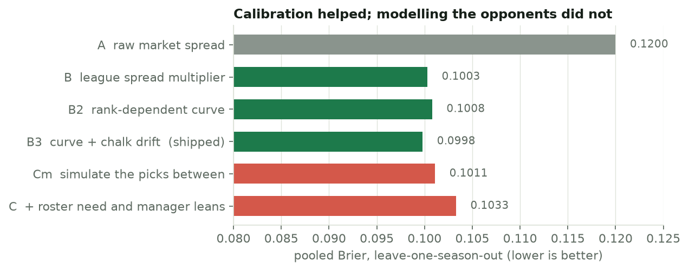
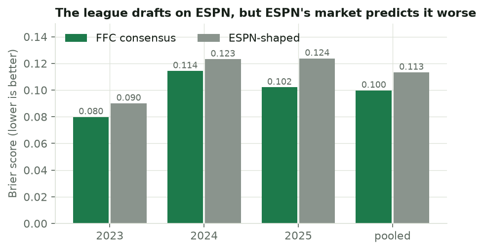
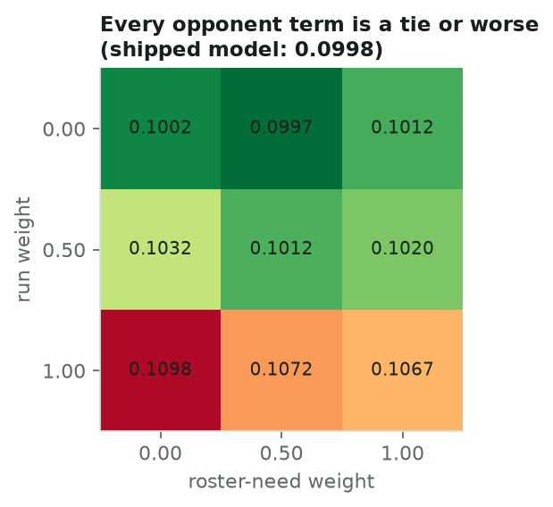
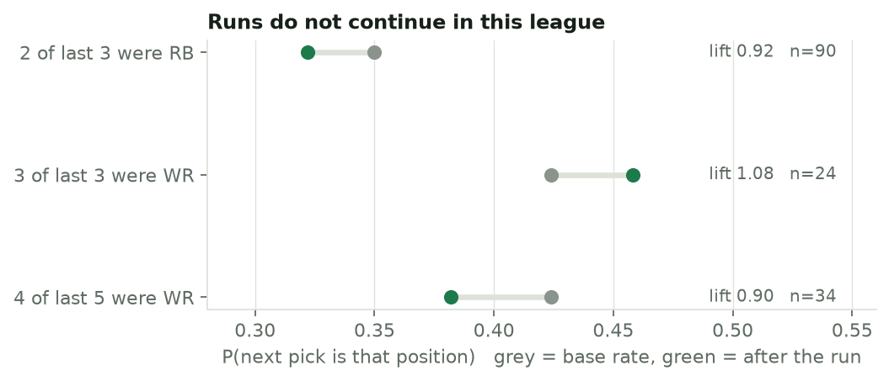
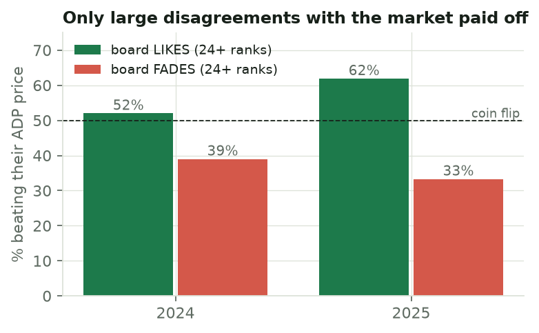
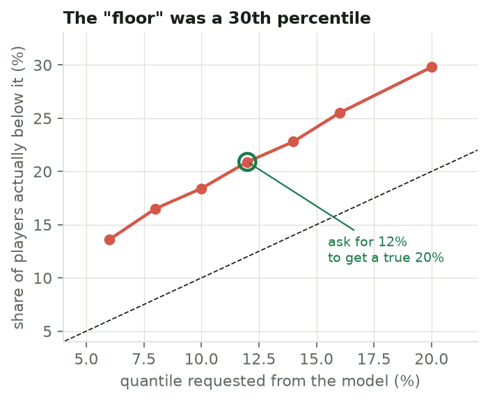

# Results: what I tested, and what I killed

Snakebite answers one question: *will this player still be there at my next
pick?* Most of the work was deciding what **not** to put in the answer. This page
is the evidence — including the things that failed, which is most of it.
Four were rejected on the original data and a fifth, live drift, was tested last.

**Ground truth.** The only labelled data for this question is what actually
happened in a real league's drafts: **391 picks over 2023–25** (361 human, 30
autodrafted), with the league anonymised in this repo. At every human turn,
for every plausible player still on the board, the models predict whether he
survives to that manager's *next* turn, scored by Brier score (lower is better),
**leave-one-season-out** so every number is out-of-sample.

**Scope, up front.** One league, three seasons, ~6,000 scored events per season
(heavily overlapping). That is enough to reject things and to fit a small number
of parameters; it is not enough to learn per-manager behaviour. That limit is the
reason for most of the conclusions below.

---

## What survived: calibrating the market's spread

The prior is a draft-position market (ADP) with a per-player spread. Taken at face
value, that spread is too tight for this league. Two small fixes account for
almost all of the gain:

| model | pooled Brier | |
|---|---|---|
| A — raw market spread | 0.1200 | baseline |
| B — × a league spread multiplier | 0.1003 | **−16.4%** |
| B2 — multiplier that depends on rank | 0.1008 | |
| **B3 — B2 + a pooled chalk drift** | **0.0998** | shipped |

The multiplier is strongly rank-dependent: round 1 is *chalk* (the league tracks
the market tighter than the market's own drafters, ~0.7×) while the middle rounds
run ~2.1×. A single flat multiplier over-widened the top of the board and broke a
conservation check (expected number of players gone by pick *n* should match
*n*), which is why the shipped model uses the curve. The chalk drift (+0.285 σ,
95% CI [+0.046, +0.524], pooled over ranks 1–84) says players go slightly *later*
than their market rank.

Be honest about the size of the second step: B → B3 is 0.0005, inside the noise
of three seasons. **The 16% is the spread multiplier; the rest is housekeeping.**

*Reproduce:* `python scripts/replay_brier.py`

---

## Four things I tested and killed

### 1. ESPN's ADP as the prior — rejected, though the league drafts on ESPN

The obvious move: if the league drafts on ESPN, use ESPN's ADP. It is
significantly **worse** than the pooled consensus, in every season.

Pooled Brier 0.0998 (consensus) vs 0.1133 (ESPN-shaped); consensus minus ESPN is
−0.0136, CI [−0.0162, −0.0110] over 343 turns (negative = consensus better). It is worse in every rank band
and every position except RB, and TE is the extreme (0.1185 vs 0.2037).

> *Drafting on ESPN is not drafting like ESPN.*

ESPN publishes no usable ADP history and no per-player spread, so the ESPN prior
was built by translating consensus rank into ESPN rank with an isotonic map
(`espn_translate.py`). That map is trustworthy to about rank 120 and collapses
beyond it (WR residual 119 ranks), so the panel reads deep players as *unknown*
rather than confident. The Sleeper and ESPN tabs in the panel borrow the
consensus spread for the same reason.

*Reproduce:* `python scripts/replay_market.py`

### 2. Opponent behaviour in the probabilities — rejected three times

"If the manager picking before me needs a WR, can I wait on the RB?" The answer
turned out to be no: he takes the RB often enough that *assuming otherwise makes
the forecast worse.* Three independent designs:

1. **Full strength** — need and manager leans fed in directly.
2. **Strength scan** — need and lean as dials over a 5×5 grid. The surface rose
   monotonically in both; the optimum was both **off**, and need was ~50× more
   harmful than lean.
3. **Redesigned estimand** — fixing three specific weaknesses of the first two:
   dilution (personalise only the few players in contention), the wrong signal
   (use live *runs* instead of static need), and no urgency term.

The shipped model scores 0.09976. The run term is actively harmful and monotone
in its dial. The nominal best cell beats the shipped model by 0.00009, CI
[−0.00124, +0.00151] — a tie, and it is the minimum of nine cells, which is
exactly how a fake finding gets manufactured, so it is not reported as a result.
A pick-by-pick simulation (rows Cm and C in the ladder above) also lost to the
plain conditional normal: 0.1011 and 0.1033 vs 0.1003.

**Consequence:** opponent information is *displayed with its provenance and
sample size* and never enters a probability. The opponent view is facts ("took
his first QB in round 3, 24 picks"), not predictions. This is also why league
import (below) only re-fits the market's spread and drift, not manager models.

*Reproduce:* `python scripts/need_redesign.py` (the grid takes a while; the
verdict and table are in that file's docstring).

### 3. Positional runs — they do not continue

The reflex is "WRs are flying off the board — get one now." Measured on the 391
picks, the next pick is *not* more likely to be that position:

Every lift is inside noise of 1.0, and the WR ones lean slightly negative. A WR
run looks like a signal only because **WR is 42% of every skill pick** in this
league anyway. The panel therefore reports run *counts* and never adjusts a
probability for one.

### 4. The project's own player ranking lost to ADP

The board also ranks players by projected value over replacement (a LightGBM
projection model). The question that decides a season: at the draft table, does
ranking by the board beat ranking by ADP? The board was rebuilt for 2024 and
2025 *as it would have been built at the time* (nothing from the test year in
training, and the hand-written 2026 stances excluded as a leak) and scored on
actual season points.

| 2024 | 2025 | |
|---|---|---|
| ADP ranks the top 120 better | ADP ranks the top 120 better | rank correlation 0.439 vs 0.388; 0.397 vs 0.322 |
| board won 0 of 12 draft slots by value, 2 of 12 by durability-adjusted rank | 6 of 12 by value, 3 of 12 by adjusted rank | simulated drafts at every slot; the script itself says to read this as a direction, not a measurement |

So ADP was kept as the ordering. What *did* survive is narrow: where the board
disagrees with the market by **24 or more ranks**, the disagreement pointed the
right way, and mild disagreements were noise.

Players the board liked by 24+ ranks beat their price 52% and 62% of the time;
players it faded by 24+ beat their price 39% and 33% of the time. The cohorts
are small (21–41 players), so treat it as suggestive. The panel shows the
model's opinion only as a badge at 24+ ranks and only inside the ADP top 150 —
the one range it was measured on.

*Reproduce:* `python scripts/board_backtest.py`

---

## A fifth, tested last: updating the drift live

Every room runs a little early or late against ADP, and the model treats that as
one fixed number (+0.285 σ, from three seasons). The natural upgrade is to
re-estimate it *during* the draft from the picks already made, shrunk toward the
league value. It is the one idea in this project that is cheap, plausible and
testable on exactly the data above, so it was tested the same way.

| year | live, K=5 | K=10 | K=20 | K=40 | static (shipped) |
|---|---|---|---|---|---|
| 2023 | 0.0807 | 0.0805 | 0.0803 | 0.0801 | **0.0799** |
| 2024 | 0.1155 | 0.1154 | 0.1151 | 0.1148 | **0.1144** |
| 2025 | 0.1030 | 0.1028 | 0.1027 | 0.1024 | **0.1021** |
| pooled | 0.1007 | 0.1005 | 0.1003 | 0.1001 | **0.0998** |

It loses in every season at every prior strength, and it gets monotonically
*better* as it is allowed to move *less*. The likely reason is in the data
rather than the method: the drift is stable across seasons (+0.29, +0.28, +0.28
at 8, 10 and 10 teams), so there is almost no room-to-room variation to learn,
and a few dozen noisy picks add more variance than information. Not shipped.

*Reproduce:* `python scripts/replay_brier.py` (the live-drift table prints last).

---

## Shortlist survival: the one thing that shipped from this round

Per-player odds do not answer the question a drafter actually has: *will at
least one of my three targets still be there?* The natural answer,
Q = 1 − ∏(1 − pᵢ), assumes the targets survive independently — and they do not,
because a fixed number of picks happens between your turns. So it was tested the
same way as everything else, on 343 real turns, with shortlists chosen *without*
looking at the model's own probabilities (the best N available; N drawn from the
best 3N; and the N nearest the coming pick, which is the easy case and is shown
only to explain why it is not the test).

| shortlist (N=3) | Brier, best single target | Brier, independent Q | mean predicted | actually survived |
|---|---|---|---|---|
| the best three available | 0.1659 | **0.0921** | 0.718 | 0.781 |
| three of the best nine | 0.1284 | **0.0651** | 0.815 | 0.886 |

Combining the targets is a large improvement over reporting only the likeliest
one — roughly half the error. But it is **systematically 6–7 points low**:
predicted 0.72 where 0.78 survive, and the same direction in every shortlist,
every N and every gap length. That is what the conservation argument predicts
(a fixed number of departures makes "every target gone" rarer than independent
coin flips say).

The obvious repair, Q = 1 − ∏(1 − pᵢ)^γ with γ > 1, improves the in-sample
score by ~5% — and then **fails the project's own standard**: the γ chosen on two
seasons swings between 1.0 and 3.0 when applied to the third, and the held-out
Brier for the best-three shortlist is 0.0961, *worse* than plain independence
(0.0921). So no correction is shipped. The panel shows the plain number and says
on the card that it ran 6–7 points low in replay: the cautious side, with the
direction stated. Select targets with **◎ Target** in any player's detail view.

*Reproduce:* `python scripts/replay_shortlist.py`

---

## A calibration bug I found in my own output

The board labels one projection a "floor" (the 20th percentile) and another a
"ceiling" (the 80th). Walk-forward over 2020–24, **29.8% of players finished
below the "floor"**, while the ceiling was close to right (79.5%).

The regularised tree model cannot reach the fat left tail of career-collapse
seasons, so it under-predicts downside. The fix is not a new feature; it is
asking for the quantile you actually want. Requesting 12% delivers a true 20%,
and in leave-one-season-out checks the held-out coverage is within 1.0
percentage point of target on average (19.9%–21.9% across the five seasons).
The ceiling is left alone (2.7 points mean error, noisier). Per-position alphas
were considered and rejected: four parameters on ~350 rows each.

*Reproduce:* `python scripts/calibrate_quantiles.py`

---

## Known limitations

- **The board runs ~7% pessimistic on availability** — it expects more players
  gone than can be. That biases the panel toward taking players early, and
  `validate_board.py` prints it on every run rather than hiding it.
- **One league.** The curves are fitted on one room's history. `league_import.py`
  re-fits them on yours; until then, other rooms and other platforms are an
  assumption, and the panel says so on each tab.
- **Three seasons.** Enough to reject, not enough to learn individuals. The
  per-manager numbers are shrunk toward the league mean for this reason, and a
  manager with no history sits exactly on it.
- **ESPN deep ADP is noise** past roughly the 120th player (see §1).
- **Brier scores are not decisions.** A better-calibrated probability is not the
  same as a better draft; the simulated-draft results above are the honest
  reminder of that.

## Reproducing everything

| claim | command |
|---|---|
| Brier ladder (A → B3, C) and live drift | `python scripts/replay_brier.py` |
| ESPN vs consensus | `python scripts/replay_market.py` |
| Opponent weight / runs | `python scripts/need_redesign.py`, `scripts/scan_opponent_weight.py` |
| Board vs ADP backtest | `python scripts/board_backtest.py` |
| Shortlist survival | `python scripts/replay_shortlist.py` |
| Floor / ceiling coverage | `python scripts/calibrate_quantiles.py` |
| These figures | `python scripts/results_figures.py` (needs `requirements-docs.txt`) |

The figures script holds the numbers as copied from those outputs, with the
source script named beside each one.
